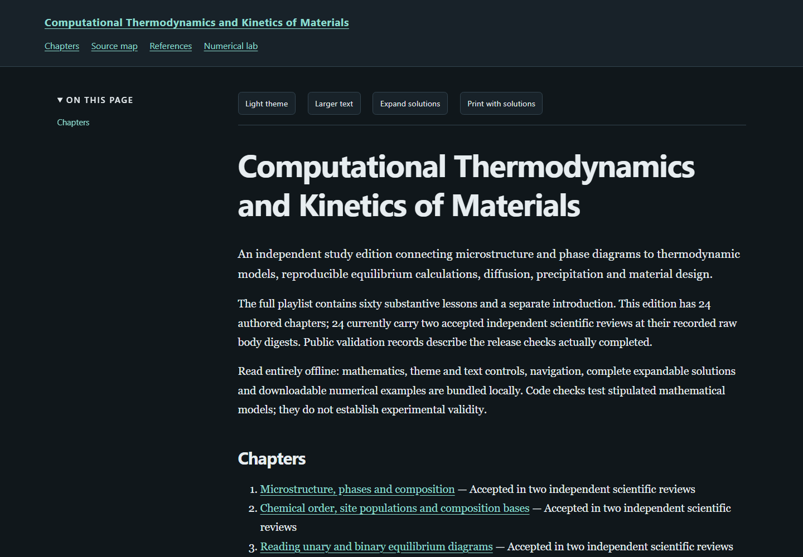

# Computational Thermodynamics and Kinetics of Materials

An independent study edition following the NPTEL course by **Prof. K. Guruvidyathri, University of Hyderabad**. IIT Madras coordinates NPTEL distribution. Attribution does not imply endorsement.

**24 substantial chapters · all 60 substantive lessons · 212 problems with complete solutions · 24 executable chapter programs.** The separate introductory recording is retained in the source inventory. Chapters cover physical metallurgy, thermodynamics, equilibrium and CALPHAD assessment, diffusion and transformation kinetics, screening and property models.

[Read the published book](https://az9713.github.io/nptel-computational-thermodynamics-kinetics-materials-notes/) or open [index.html](index.html) locally. Mathematics, figures, navigation, theme and text controls, code copying, printing and expandable solutions work offline.

[Study guide](book-overview.html) · [Recording source map](source-map.html) · [Numerical laboratory](numerical-lab.html) · [Primary references](references.html)

The chapters distinguish recording material, original teaching constructions and primary-source extensions. Every complete local machine transcript was read by the corresponding author; no complete audiovisual or board-equation audit is claimed. Original synthetic examples do not validate a real material model. Source access limits and scope are stated beside the relevant discussions.

Scientific acceptance binds two independent reviews to each current raw chapter-body digest. Public evidence records report actual coverage, code, browser, package, source-free and publication checks; publication is complete only when the final served report says so.

## Rebuild and run

The full pinned numerical runtime was tested with Python 3.13. Install [requirements.txt](requirements.txt) in a project-local environment. Reading the HTML requires no Python installation.

~~~console
python -m venv work/venv
work/venv/Scripts/python -m pip install -r requirements.txt
~~~

With that environment active, run from the project directory:

~~~console
python tools/build_book.py
python tools/plot_microstructure.py
python code/plot_ch23_property_models.py
python tools/validate_book.py
python code/ch01_microstructure.py
python numerical_lab.py
~~~

The validator executes every chapter program and checks chapter-body digests, contained links, timestamps and displayed source/output. Chapters 14, 15 and 22 run actual **pycalphad 0.11.1** calculations against the supplied original synthetic TDB files. Their engine assumptions and limitations are explicit. Chapter 23 also supplies its reproducible property-model figure generator.

## Release evidence

The public tools support an exact allowlisted package, isolated reproduction from a committed Git archive and real headless browser checks at desktop and mobile widths. Final publication checks compare served bytes, including completion evidence, and separately verify the served final publication report without a self-hash claim.

[Production workflow](WORKFLOW.md) · [Source coverage](source-validation-summary.json) · [Scientific review bindings](editorial-review-summary.json) · [Completion](completion.json) · [Publication evidence](publication-validation.json)

Raw recordings, transcripts, downloaded papers, prompts, installation caches and private editorial reports remain outside the public package in ignored project-local work/.
